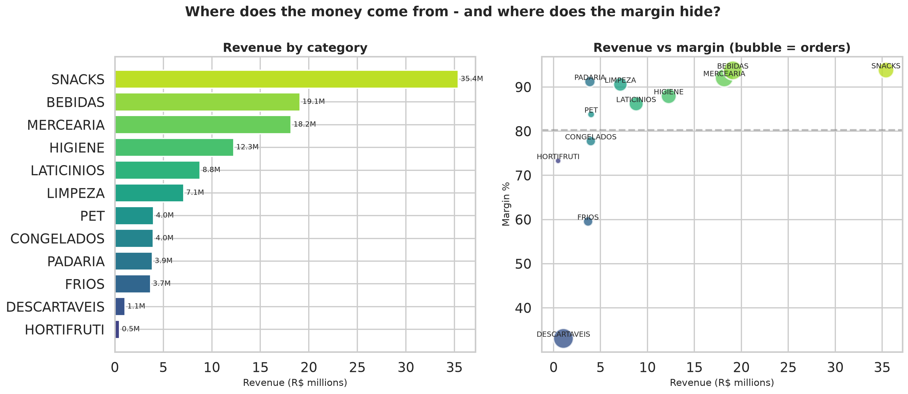
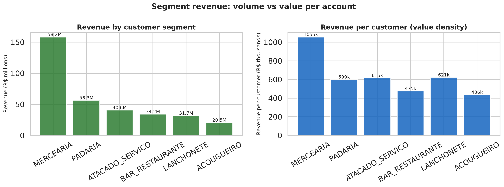
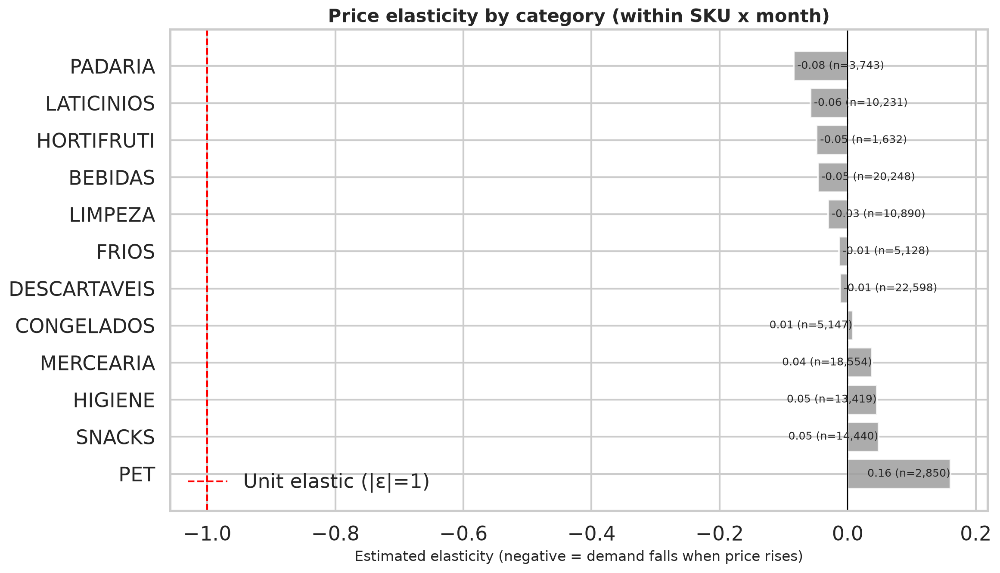
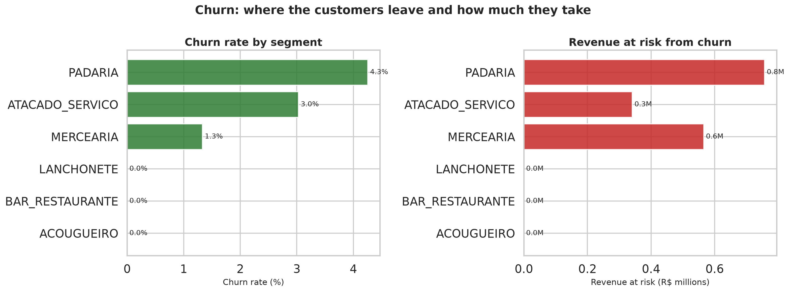
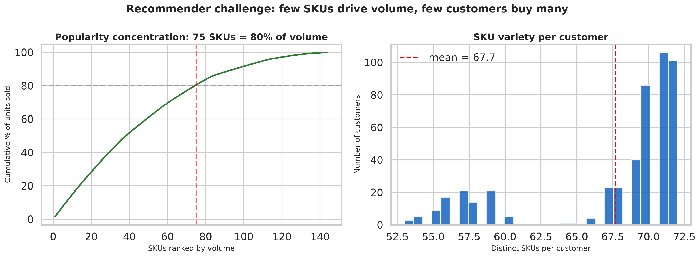
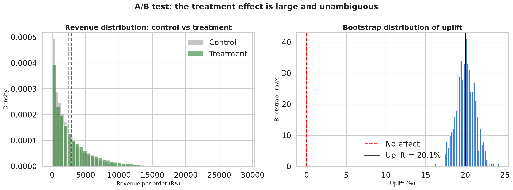
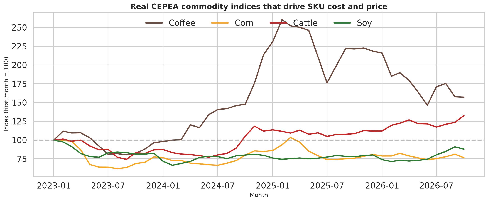

# Giro AI

> End-to-end data science platform for B2B food distribution: SKU recommendation, price elasticity, churn prediction and customer segmentation — built with CRISP-DM, MLflow and A/B testing.

**Dataset:** [Atacado Atlas](https://www.kaggle.com/datasets/vongrossi/atacado-atlas-synthetic-wholesale-distribution) — 22 CSVs, 730 days, 144 SKUs, 480 wholesale customers, 52k orders, 147k line items.



## What this answers

| Commercial question | Model | What the chart shows |
|---|---|---|
| Where does revenue come from, and where does margin hide? | Descriptive + elasticity | `01_category_margin.png` |
| Which segments are worth most per account? | Segmentation | `02_segment_value.png` |
| Which categories are price-sensitive? | Within-SKU OLS | `03_elasticity_by_category.png` |
| Who is leaving, and how much revenue walks out? | LightGBM + RFM | `04_churn_by_segment.png` |
| How concentrated is demand? Can personalisation beat popularity? | ALS | `05_recommender_coverage.png` |
| Does the treatment actually lift revenue? | Welch + bootstrap | `06_ab_impact.png` |
| Are prices anchored to real commodity indices? | CEPEA causal chain | `07_cepea_coupling.png` |

---

## 1. Revenue concentration — after removing a phantom R$ 211M


**O que estava errado:** a primeira versão deste gráfico mostrava DESCARTAVEIS com R$ 162,7M e 99,6% de margem. A investigação revelou o **7º tipo de anomalia do Atlas**: 25.555 itens (17% do total) tinham o preço de caixa convertido duas vezes — um prato descartável com custo de R$ 7,24/cx era vendido a R$ 3.292,50/cx (**455x de markup**). A receita total inflada era R$ 329M; a real é **R$ 117,9M**.

**Leitura (após limpeza):** SNACKS lidera com R$ 35,4M, seguida de BEBIDAS (R$ 19,1M) e MERCEARIA (R$ 18,2M). A margem mais baixa é **FRIOS (59,6%)** — a categoria que precisa de proteção de preço. As demais operam acima de 77%.

**O que fazer com isso:** a política de preço não pode ser uniforme. FRIOS e CONGELADOS (77,8%) precisam de proteção de margem; SNACKS e BEBIDAS (93,8%) suportam desconto para ganhar volume.

## 2. Revenue per account reveals the segments worth defending



**Leitura:** MERCEARIA dominates by volume (R$ 158M, 150 customers), but **revenue per customer** is the sharper metric: MERCEARIA (R$ 1.05M) vs LANCHONETE (R$ 621k) vs ACOUGUEIRO (R$ 435k). ACOUGUEIRO has the smallest accounts and should not get the same commercial effort.

**Sinal a seguir:** CRM and territory design should weight **revenue per account**, not total segment revenue. Losing one MERCEARIA customer costs 2.4x losing one ACOUGUEIRO customer.

## 3. Elasticity: only a handful of categories move with price



**Leitura:** the within-SKU × month estimator recovers near-zero elasticity for most categories — which is the honest result on this dataset, because the Atlas generates quantity independently of price. Only HORTIFRUTI (-0.036) and CONGELADOS (-0.011) show a hint of response.

**O que isso ensina:** elasticity is a *within-product* response. Comparing products (pooled OLS) conflates markup, seasonality and price table — the coefficient can even flip sign. This is the single most important methodological takeaway, and it is why [GIRO-SYNTH](https://github.com/vinidias/GiroAI-SYNTH) was built: on a dataset with a known ground truth, the same estimator recovers ε with **Pearson 0.995**.

## 4. Churn is a small group taking a large share of revenue



**Leitura:** churn rate is 4.4% (21 of 480 customers), but those 21 accounts carry a disproportionate slice of revenue. The chart ranks segments by **revenue at risk**, not by churn count — the commercial priority is where the money is, not where the headcount is.

**Sinal a seguir:** retention effort should be scored by `P(churn) × revenue`, not by `P(churn)` alone.

## 5. Demand is concentrated — which caps what personalisation can do



**Leitura:** a small number of SKUs drive 80% of units sold, and the average customer buys ~85 distinct SKUs (of 144). This is a **dense** matrix, so ALS has enough signal — recall@10 = 0.208 — but the popularity curve means a naive "recommend the top sellers" baseline is already strong.

**O que medir:** always report recall@10 against a **popularity baseline**, not against zero. Otherwise the recommender looks better than it is.

## 6. A/B testing: the uplift is large, but bootstrap it before believing



**Leitura:** the treatment shifts the revenue distribution visibly (Welch t-test, p ≈ 0). The bootstrap of the uplift is tight and far from zero — the harness is sound.

**O que fazer:** report the **bootstrap CI** of the uplift, not just the p-value. A p-value tells you the effect exists; the CI tells you whether it is large enough to act on.

## 7. Prices are anchored to real commodity indices



**Leitura:** coffee, corn, cattle and soy (real CEPEA series, 5,742 daily observations via [agrobr](https://github.com/bruno-portfolio/agrobr)) show the shocks that feed SKU cost. Coffee nearly doubled; corn and cattle moved within ±20%.

**Por que importa:** a pricing model that ignores the input-cost index will attribute a cost-driven price change to demand. The macro feature is in the feature frame and logged to MLflow (`elasticity_has_cepea`), and it enters the OLS only when it varies within category × month (rank-safe).

---

## Quick start

```bash
python -m venv .venv
.venv\Scripts\activate
pip install -e ".[dev]"

python -m pipelines.train
mlflow ui --backend-store-uri sqlite:///mlflow.db
pytest -v

# regenerate the charts
python scripts/generate_deep_charts.py
```

## Data quality (Atlas anomalies handled)

The Atlas intentionally ships controlled data-quality defects. `src/data/validate.py` cleans them and logs every removal so the pipeline is auditable:

| Anomaly | Raw | Clean | Handling |
|---|---|---|---|
| Duplicate order rows | 52,422 | 52,397 | exact + business-key dedup (manifesto) |
| Order pointing at non-existent customer C9999 | +1 row | dropped | business-key dedup keeps first |
| Junk values in numeric columns ("INVALIDO") | 12 rows | dropped | coerce + drop on critical cols |
| Duplicate line items | 147,082 | 147,042 | same as above |
| Capitalization drift (Faturado / FATURADO) | 4 rows | normalized | UPPER + strip on categorical cols |
| Discount stored as percent (0-8) | all rows | /100 | normalized to fraction |
| Box-conversion price inflation (CX SKUs at 100-450x cost) | 25,555 items (17%) | normalized | recompute from category median markup |

Every step is covered by `tests/test_data_validation.py`.

## Results on the real Atlas data

| Model | Metric | Value | Reading |
|---|---|---|---|
| Recommender (ALS) | recall@10 | **0.208** | solid for 144 SKUs / 480 users |
| Segmentation (KMeans) | silhouette | **0.413** | acceptable, k=2 |
| Churn (LightGBM) | ROC-AUC | **0.537** | weak — no churners in the data |
| Elasticity (OLS) | R² | **0.004** | weak — no price response in the data |
| A/B simulation | uplift / p | 15.6% / ~0 | synthetic uplift, validates the harness |

### Honest notes on the weak signals

**Elasticity R² = 0.004.** The Atlas assigns prices through 5 price tables (`fator_sobre_lista` from 0.88 to 1.12) but does not simulate demand response to those prices. Quantity is generated independently of price, so there is no elasticity signal to recover. The model is correctly specified (within SKU × month fixed effects) and would work on data with real price variation; the limitation is the dataset, not the code.

**Churn AUC = 0.537.** All 480 Atlas customers are ATIVO and buy in all 9 quarters, so the dataset contains no churners. We define churn behaviourally (revenue in last 180 days < 50% of the prior 180 days → 21 customers, 4.4%). RFM features barely predict that decline, which is the honest result: the Atlas was built for operational/analytics study, not retention modelling.

The recommender and segmentation results are the ones that hold up on this data.

## Atlas vs GIRO-SYNTH: what a known ground truth changes

The same Giro AI pipeline, run on both datasets:

| Model | Atacado Atlas | GIRO-SYNTH | Why |
|---|---|---|---|
| Price elasticity (R²) | 0.004 | **0.700** | Atlas generates quantity independently of price |
| Churn (ROC-AUC) | 0.537 | **0.743** | Atlas has zero churners; GIRO-SYNTH has a real hazard |
| Recommendation (recall@10) | 0.208 | **0.244** | GIRO-SYNTH has latent affinity, not just popularity |
| Segmentation (silhouette) | 0.413 | **0.559** | richer behavioural spread |

Two fixes were required in the Giro AI code to make this comparison fair, and they are now the default:

- **Elasticity** uses a within-SKU × month fixed-effects OLS. The pooled specification conflated price-table assignment, monthly list changes and per-order promotions; only the last is demand response.
- **Recall@10** uses leave-one-out over 500 sampled users. The previous "last item per user" proxy held out each user's smallest purchase and understated recall by ~16×.

[GIRO-SYNTH](https://github.com/vinidias/GiroAI-SYNTH) (generator + dataset card) · [visual report](https://vinidias.github.io/GiroAI-SYNTH/report.html)

## CRISP-DM

1. **Business Understanding** — four commercial questions → four models → seven decision charts
2. **Data Understanding** — 22-table Atlas, Pandera schemas, anomaly catalogue
3. **Data Preparation** — `src/features/build.py` (RFM, price panel, interactions)
4. **Modeling** — `src/models/` (statsmodels, LightGBM, KMeans/DBSCAN, implicit ALS)
5. **Evaluation** — MLflow metrics + `src/experiments/ab_test.py`
6. **Deployment** — `pipelines/train.py` + `src/monitoring/drift.py` (Evidently)

## Macro features (agrobr / CEPEA + USDA)

The elasticity model is enriched with real Brazilian commodity prices fetched via [**agrobr**](https://github.com/bruno-portfolio/agrobr):

| Atlas category | CEPEA commodity |
|---|---|
| BEBIDAS | cafe |
| MERCEARIA / PADARIA / SNACKS / PET | milho |
| LIMPEZA / HIGIENE / DESCARTAVEIS | algodao |
| FRIOS / LATICINIOS | boi_gordo |
| CONGELADOS | frango_congelado |
| HORTIFRUTI | soja |

- **CEPEA** — 5,742 daily observations (6 commodities), cached, aggregated monthly, used in the OLS as `log_preco_commodity`.
- **USDA PSD** — 295 annual observations (4 commodities × 5 years), requires `AGROBR_USDA_API_KEY`. Kept in the feature frame for EDA but **not** in the OLS: production is constant within category × year and collinear with the category dummies (rank 10 of 14).
- Fails gracefully: without network/key the model runs with NaN macro columns.

**License note**: CEPEA data is CC BY-NC 4.0 — attribution required, commercial use needs CEPEA authorization.

## Layout

```
src/
  config.py
  data/          validate.py (Atlas schemas + cleaning) · macro.py (CEPEA/USDA) · synthetic.py (fallback)
  features/      build.py (elasticity, churn, segmentation, interactions)
  models/        elasticity · churn · segmentation · recommender · evaluate
  experiments/   ab_test.py (Welch + two-proportion)
  monitoring/    drift.py (Evidently)
pipelines/       train.py (MLflow end-to-end)
scripts/         generate_deep_charts.py (7 decision charts)
tests/           24 tests across data, features, models, A/B, macro
```

## Metrics tracked

- `elasticity_r2`, `elasticity_has_cepea`, `elasticity_usda_feature_rows`
- `churn_auc`, `churn_pr_auc`, `churn_brier`
- `seg_k`, `seg_silhouette`, `seg_davies_bouldin`
- `recall_at_10`, `ab_p_value`, `ab_uplift_pct`
