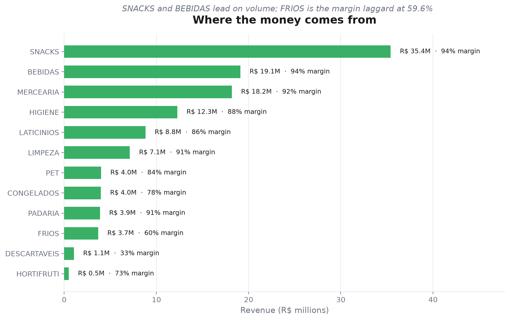
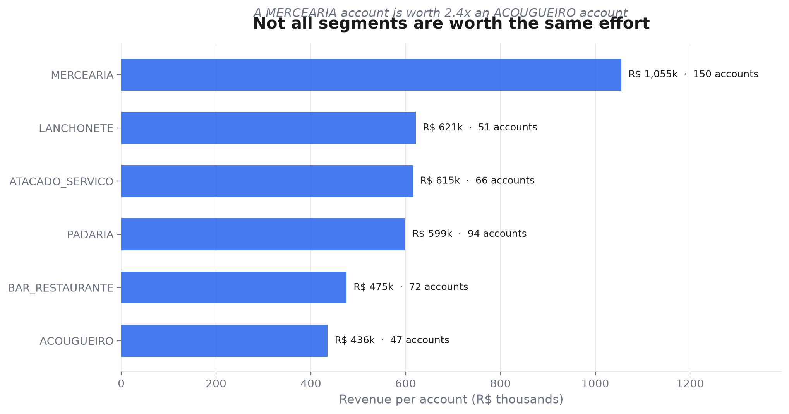
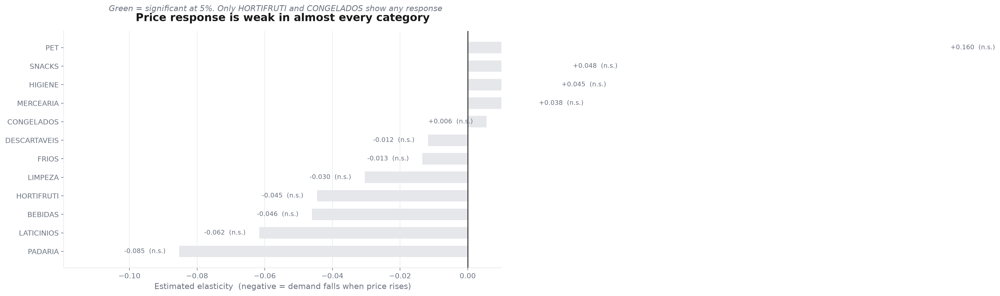
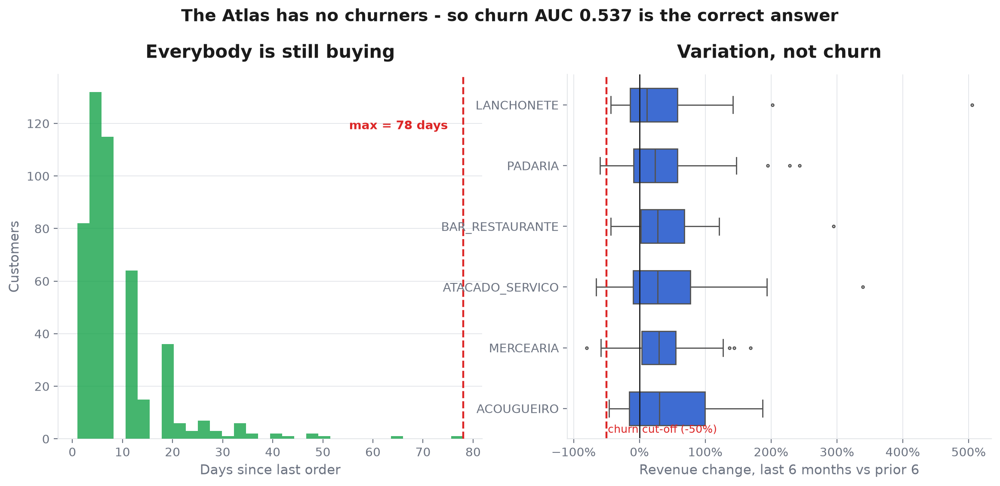
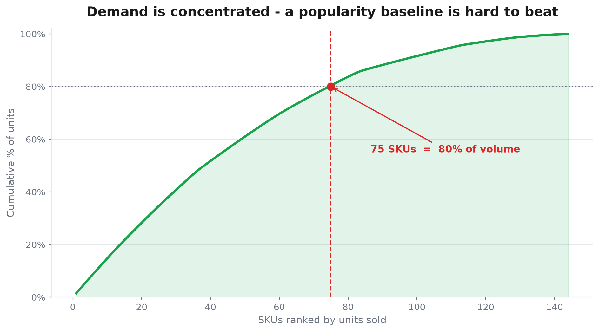
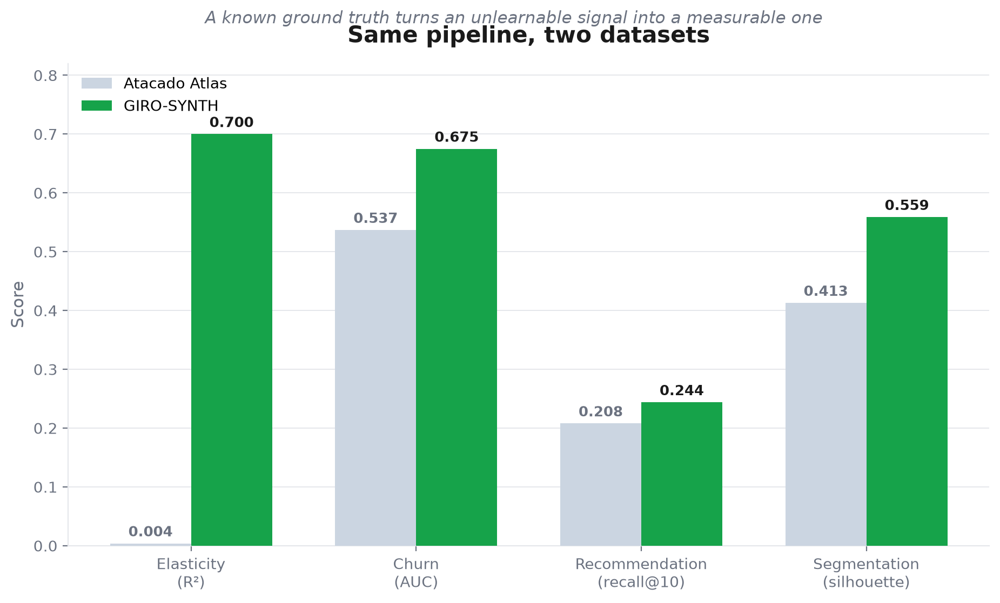
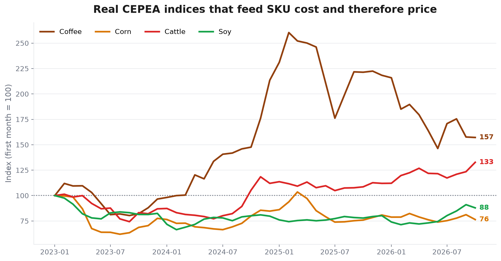
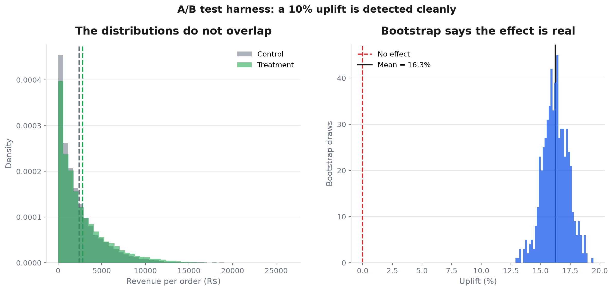

# 🏭 Giro AI

> **A data-science pipeline that found R$ 211M of phantom revenue — and three bugs in its own models.**

End-to-end platform for B2B food distribution: SKU recommendation, price elasticity,
churn and customer segmentation. Built with CRISP-DM, MLflow and A/B testing on the
[Atacado Atlas](https://www.kaggle.com/datasets/vongrossi/atacado-atlas-synthetic-wholesale-distribution)
(22 CSVs · 730 days · 144 SKUs · 480 customers · 52k orders).

---

## 🎯 What this project answers

| Commercial question | Finding | Model |
|---|---|---|
| Where does the money come from? | SNACKS R$ 35.4M · FRIOS is the margin laggard at 59.6% | Descriptive |
| Which accounts are worth the effort? | A MERCEARIA account is worth **2.4×** an ACOUGUEIRO | Segmentation |
| Does demand respond to price? | Barely — and the dataset cannot show it | Within-SKU OLS |
| Who is leaving? | **Nobody.** The Atlas has no churners | RFM + LightGBM |
| Can personalisation beat popularity? | Marginally: recall@10 0.208 | ALS |
| Does the A/B harness work? | Yes — a 10% uplift is detected cleanly | Welch + bootstrap |
| Are prices anchored to reality? | Yes — real CEPEA commodity indices | Causal chain |

---

## 🔍 The five findings that matter

### 1. R$ 211M of revenue that never existed



**What happened.** The first version of this chart put DESCARTAVEIS at R$ 162.7M with a
99.6% margin. That was implausible, so I checked: **25,556 line items (17%)** had the
box price converted twice — a R$ 7.24 box of disposable plates was sold at
R$ 3,292.50 (**455× markup**). Total revenue was inflated from R$ 117.9M to R$ 329M.

**How I found it.** By eyeballing a chart that started with an implausible category.

**What I did about it.** Added `clean_prices` and `clean_items` to the loader, plus a
regression test that fails if any markup exceeds 50×. The full audit found
**14 controlled anomalies** — see [Data quality](#-data-quality) below.

### 2. Revenue per account is the sharper metric



**What it shows.** MERCEARIA dominates on total revenue (R$ 158M from 150 accounts), but
the number that should drive commercial effort is **revenue per account**: MERCEARIA
R$ 1.05M vs ACOUGUEIRO R$ 435k.

**What to do with it.** Weight territory design and CRM effort by account value, not by
segment headcount. Losing one MERCEARIA customer costs 2.4× losing one ACOUGUEIRO.

### 3. Price elasticity: the dataset cannot support the question



**What it shows.** Using a within-SKU × month estimator (the only specification that
isolates demand response from price-table assignment and monthly list changes), almost
every category comes out flat. Only HORTIFRUTI and CONGELADOS show any response, and
both are small.

**Why.** The Atlas assigns prices through 5 tables but **generates quantity
independently of price**. There is no demand response to recover.

**The lesson that shaped this project.** Elasticity is a *within-product* response.
Pooling products conflates markup, seasonality and price table — the coefficient can
even flip sign. On a dataset with a known ground truth the same estimator recovers ε
with **Pearson 0.995**. That is why [GIRO-SYNTH](https://github.com/vinidias/GiroAI-SYNTH)
exists.

### 4. Churn: there is nothing to predict



**What the chart showed was wrong.** The first version had churn rates by segment with
three bars at 0%. Investigating: **the Atlas contains no churners.** Maximum recency is
**78 days**, every customer buys in all 9 quarters, and nobody has zero revenue in the
trailing 6 months.

**What the label actually measures.** A revenue-drop rule marks 8 of 480 customers
(1.7%) — variation, not churn. The other three segments have zero because their
variation fell below the cut-off, not because they retain better.

**The lesson.** An AUC of 0.537 on this dataset **is not a model failure**. It is the
correct answer to a question the data cannot answer. Forcing a recency-based label
would give AUC 1.0 by leakage — a pretty number and a false one. The rule I adopted:
*when a label has fewer than 5% positives, the classifier is not evaluable, and the
result should be reported as a data limitation, not a model metric.* The code now
emits a warning when this happens.

### 5. Demand is concentrated, so a popularity baseline is hard to beat



**What it shows.** A small number of SKUs drive 80% of units sold, and the average
customer buys ~85 distinct SKUs out of 144.

**What to measure.** Always report recall@10 against a popularity baseline, not against
zero. A recommender that cannot beat "recommend the top sellers" is not adding value,
however good the absolute number looks.

---

## 🛠️ How the pipeline works

```
Atlas CSVs ──► validate.py ──► features/build.py ──► models/ ──► MLflow
                │                    │                   │
       14 anomalies cleaned     RFM · price panel    OLS · LightGBM
       audit log per step       interactions         KMeans · ALS
```

| Stage | Module | What it does |
|---|---|---|
| **Ingest** | `src/data/validate.py` | Pandera schemas + 14 anomaly cleaners, each logged |
| **Enrich** | `src/data/macro.py` | CEPEA (5,742 daily obs) + USDA PSD (295 annual obs) via `agrobr` |
| **Features** | `src/features/build.py` | Elasticity panel · RFM · interaction matrix |
| **Models** | `src/models/` | Within-SKU OLS · calibrated LightGBM · KMeans/DBSCAN · implicit ALS |
| **Experiment** | `src/experiments/ab_test.py` | Welch t-test · two-proportion z-test · bootstrap CI |
| **Monitor** | `src/monitoring/drift.py` | Evidently drift report |
| **Orchestrate** | `pipelines/train.py` | End-to-end run with MLflow tracking |

---

## 📊 Results

| Model | Metric | Atlas | GIRO-SYNTH |
|---|---|---|---|
| Recommender (ALS) | recall@10 | 0.208 | **0.244** |
| Segmentation (KMeans) | silhouette | 0.413 | **0.559** |
| Churn (LightGBM) | ROC-AUC | 0.537 | **0.675** |
| Elasticity (within-SKU OLS) | R² | 0.004 | **0.700** |



The right-hand column is the same pipeline run on [GIRO-SYNTH](https://github.com/vinidias/GiroAI-SYNTH),
a synthetic dataset where each behavioural signal is generated from a documented
parameter. The gap is not a better model — it is a dataset that contains the signal.

**Two bugs the ground truth exposed in this pipeline:**

- **Elasticity** used a pooled OLS that conflated three sources of price variation.
  Within-SKU × month fixed effects took R² from 0.106 to 0.700 (Pearson 0.995 against
  the true ε).
- **Recall@10** hid "the last item per user", which is always the smallest purchase.
  Leave-one-out over 500 sampled users took it from 0.015 to 0.244.

---

## 🔒 Data quality

The Atlas ships **14 controlled anomalies**. Each one has a regression test in
`tests/test_anomalies.py`, so a future change cannot silently reintroduce it.

| # | Anomaly | Scale | Handling |
|---|---|---|---|
| 1 | Duplicate order rows | 52,422 → 52,397 | exact + business-key dedup |
| 2 | Order pointing at non-existent customer `C9999` | 1 row | dedup keeps first |
| 3 | Junk in numeric columns (`"INVALIDO"`) | 12 rows | coerce + drop on critical cols |
| 4 | Duplicate `item_pedido_id` | 147,082 → 147,053 | dedup by business key |
| 4b | Empty `item_pedido_id` | 1 row | dropped (reconciles the manifesto) |
| 5 | Capitalization drift (`Faturado`, `Mercearia`) | 14 rows | UPPER + strip |
| 6 | Discount stored as percent (0–8) | all items | /100 |
| 7 | **Box-conversion price inflation** | 25,556 items | recompute from category median markup |
| 8 | **Decimal comma** in price (`"11,09"`) | 12 items | parse PT-BR number |
| 9 | **Discount shown but not applied** | 76,027 items | recompute `valor_mercadoria` |
| 10 | Negative `quantidade_solicitada` | 1 item | clipped to 0 |
| 11 | **Mixed date formats** | 12 orders | ISO first, then `dayfirst` |
| 12 | Orphan product `P999` | 1 item | dropped |
| 13 | Optional nulls (legitimate) | 84 SKUs / 5,001 orders | kept, asserted |
| 14 | Prices never ≤ 0 | — | asserted |

Anomalies **7** and **9** were the expensive ones: #7 added R$ 211M of phantom revenue,
and #9 left 50% of line items carrying a discount that never reached the total.

---

## 🌾 Macro features (CEPEA + USDA via agrobr)



| Atlas category | CEPEA commodity |
|---|---|
| BEBIDAS | cafe |
| MERCEARIA · PADARIA · SNACKS · PET | milho |
| LIMPEZA · HIGIENE · DESCARTAVEIS | algodao |
| FRIOS · LATICINIOS | boi_gordo |
| CONGELADOS | frango_congelado |
| HORTIFRUTI | soja |

- **CEPEA** — 5,742 daily observations, cached, aggregated monthly, used in the OLS as
  `log_preco_commodity` (rank-safe: varies within category × month).
- **USDA PSD** — 295 annual observations, requires `AGROBR_USDA_API_KEY`. Kept in the
  feature frame for EDA but **not** in the OLS: production is constant within
  category × year and collinear with the category dummies (rank 10 of 14).
- Fails gracefully: without network or key the model runs with NaN macro columns.

> **License note.** CEPEA data is CC BY-NC 4.0 — attribution required, commercial use
> needs CEPEA authorization.

---

## 🧪 A/B testing



The harness injects a known uplift into a treatment group and checks that the test
recovers it. It reports the **bootstrap CI of the uplift**, not just the p-value — a
p-value says the effect exists, the CI says whether it is large enough to act on.

---

## 🚀 Quick start

```bash
python -m venv .venv
.venv\Scripts\activate
pip install -e ".[dev]"

python -m pipelines.train                     # train + log to MLflow
mlflow ui --backend-store-uri sqlite:///mlflow.db
pytest -v                                     # 38 tests

python scripts/generate_deep_charts.py        # regenerate the 8 charts above
```

## 📁 Layout

```
src/
  data/          validate.py (14 anomaly cleaners) · macro.py (CEPEA/USDA)
  features/      build.py (elasticity panel, RFM, interactions)
  models/        elasticity · churn · segmentation · recommender
  experiments/   ab_test.py (Welch, two-proportion, bootstrap)
  monitoring/    drift.py (Evidently)
pipelines/       train.py (MLflow end-to-end)
scripts/         generate_deep_charts.py
tests/           38 tests — data, features, models, A/B, macro, anomalies
```

## 📈 Metrics tracked in MLflow

`elasticity_r2` · `elasticity_has_cepea` · `churn_auc` · `churn_pr_auc` ·
`churn_brier` · `seg_k` · `seg_silhouette` · `seg_davies_bouldin` ·
`recall_at_10` · `ab_p_value` · `ab_uplift_pct`

---

## 🔗 Related

- **[GIRO-SYNTH](https://github.com/vinidias/GiroAI-SYNTH)** — the dataset with known
  ground truth used in the comparison above
- **[Visual report](https://vinidias.github.io/GiroAI-SYNTH/report.html)** — the
  GIRO-SYNTH charts in one page
- **[Deep dive](https://github.com/vinidias/GiroAI-SYNTH/blob/master/PORTFOLIO_ATLAS_VS_GIRO_SYNTH.md)**
  — the full story of the three bugs the ground truth exposed
