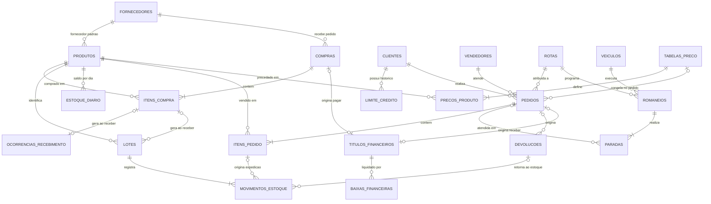
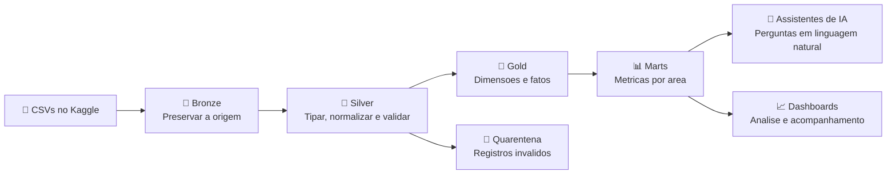

# 🧊 Atacado Atlas — Synthetic Wholesale Distribution

**Compras • Estoque por lote • Vendas B2B • Romaneio de rota • Financeiro**

## 🌎 Sobre

Dataset sintético para estudos exploratórios, simulando uma distribuidora atacadista de alimentos, bebidas e limpeza que atende mercearias, bares, padarias, açougueiros e serviços de alimentação.

Explore dois anos de operação: do crédito ao cliente e do pedido de compra ao repasse do lote na rota da semana, com expedição por FEFO, rateio de frete por peso, ocorrências de recebimento, devoluções, títulos e baixas. Os arquivos representam registros de sistemas operacionais e permitem construir um projeto completo de engenharia e análise de dados.

Este dataset é **independente** do Frutal Atlas: mesma engine de geração, mas outro domínio, outra malha e outros contratos de negócio.

## 📊 Em números

| Característica | Conteúdo |
|---|---|
| 📅 Período | 01/09/2024 a 31/08/2026 — **730 dias** |
| 📁 Arquivos operacionais | **22 CSVs relacionados** |
| 🧾 Registros brutos | **638.163** |
| ✅ Registros esperados após tratamento | **638.085** |
| 🛒 SKUs | **144**, perecíveis e não perecíveis |
| 🏪 Clientes atacadistas | **480** |
| 🌱 Fornecedores | **8** |
| 🚚 Veículos de frota própria | **7** |
| 🧭 Rotas | **8**, uma por município |
| 💼 Vendedores | **3** |
| 💳 Títulos financeiros | **49.604**, com **55.763** baixas |
| 📦 Romaneios / paradas | **832** viagens, **49.240** paradas |
| 💰 Moeda e unidade | **BRL** e **unidade de venda** |
| 🧯 Anomalias controladas | **150** |
| 🔁 Versão e seed | **1.0.0** · `18092026` |

**Arquivos de apoio:** `dicionario.csv` descreve todas as colunas; `schema.json` define tipos e granularidade; `manifesto.csv` contém contagens e hashes SHA-256 para conferir a carga.

## 🎯 O que você pode explorar?

- **Comercial:** faturamento, desconto, margem de contribuição, metas por vendedor e concentração por cliente, segmento ou rota.
- **Tabelas de preço:** SCD2 com vigência, migração de tabela de preço e efeito sobre o faturamento.
- **Crédito:** limite por cliente com vigência, bloqueio de pedido, reavaliação e exposição financeira.
- **Suprimentos:** prazo de recebimento, recebimento parcial, não conformidades e crédito do fornecedor.
- **Estoque:** rastreabilidade por lote, FEFO, validade, avarias, reposição por ponto de pedido e capital imobilizado.
- **Logística:** romaneio diário, paradas, OTIF, reagendamento e rateio de frete por peso.
- **Financeiro:** contas a pagar e receber, baixas parciais, saldos abertos e vencidos.
- **Engenharia de dados:** ingestão, qualidade, reconciliação, modelagem dimensional e criação de marts.
- **Linguagem natural:** consultas aos dados, investigação de indicadores e criação de dashboards com assistentes de IA.

## 🗂️ Arquivos e granularidade

Cada linha representa uma entidade, um evento ou um saldo. Entender essa granularidade é o primeiro passo para combinar as tabelas sem duplicar medidas.

| Arquivo | Uma linha representa | Chave |
|---|---|---|
| `produtos.csv` | Um SKU e seus atributos de venda, estoque e validade | `produto_id` |
| `clientes.csv` | Um cliente atacadista, cadastro estático | `cliente_id` |
| `fornecedores.csv` | Um fornecedor e suas faixas de bonificação | `fornecedor_id` |
| `vendedores.csv` | Um vendedor e sua meta/comissão | `vendedor_id` |
| `veiculos.csv` | Um veículo da frota própria | `veiculo_id` |
| `rotas.csv` | Uma rota com dia fixo na semana | `rota_id` |
| `tabelas_preco.csv` | Uma tabela de preço por segmento | `tabela_preco_id` |
| `precos_produto.csv` | O preço de um SKU em uma tabela, com vigência | `preco_produto_id` |
| `limite_credito.csv` | O limite de crédito de um cliente em um intervalo | `limite_credito_id` |
| `compras.csv` | Um pedido de compra | `compra_id` |
| `itens_compra.csv` | Um SKU dentro de uma compra | `item_compra_id` |
| `ocorrencias_recebimento.csv` | Uma não conformidade de um item comprado | `ocorrencia_id` |
| `lotes.csv` | Um lote recebido, devolvido ou de saldo inicial | `lote_id` |
| `movimentos_estoque.csv` | Um evento sobre um lote | `movimento_id` |
| `estoque_diario.csv` | O saldo de um SKU no fechamento do dia | `data_estoque` + `produto_id` |
| `pedidos.csv` | Um pedido comercial, com a tabela de preço congelada | `pedido_id` |
| `itens_pedido.csv` | Um SKU dentro de um pedido | `item_pedido_id` |
| `romaneios.csv` | Uma viagem da frota em um dia | `romaneio_id` |
| `paradas.csv` | Uma parada do romaneio em um pedido | `parada_id` |
| `devolucoes.csv` | Uma devolução de um SKU sobre um pedido | `devolucao_id` |
| `titulos_financeiros.csv` | Um título a pagar ou receber | `titulo_id` |
| `baixas_financeiras.csv` | Uma liquidação parcial ou total | `baixa_id` |

## 🔗 Como as tabelas se relacionam

**Leitura do diagrama:** `||` = exatamente um; `o|` = zero ou um; `|{` = um ou mais; `o{` = zero ou mais. Os relacionamentos descrevem a versão tratada, após remover duplicatas e separar registros inválidos.

| Ligação | Regra de negócio |
|---|---|
| Compra → itens → ocorrências | Um item comprado tem **no máximo uma** não conformidade. A maioria dos itens comprados não tem nenhuma. |
| Compra → itens → lotes | Um item comprado pode gerar vários lotes. Lotes de abertura ou de devolução não têm compra associada. |
| Item de venda → movimentos | Um item pode consumir vários lotes por FEFO. Movimentos de entrada, validade e avaria não apontam para um item de venda. |
| Pedido → paradas | Um pedido pode aparecer em **mais de uma** parada: até 3 tentativas quando a entrega falha e é reagendada. Isso é intencional e expõe a armadilha de join 1:N. Cancelados e pedidos sem expedição não geram parada. |
| Romaneio → paradas | Um romaneio pode ter paradas concluídas, não realizadas ou reagendadas. A última parada pode ficar aberta quando o pedido é reagendado. |
| Devolução → movimento | `tratamento` != `DESCASTE` **e** `status_devolucao` != `REJEITADA` devolve a mercadoria ao estoque, no mesmo dia, em lote novo. `PENDENTE` já retorna ao estoque aguardando laudo; `REJEITADA` não retorna nada. |
| Documento → título | Cada título está ligado a **um pedido ou uma compra**, nunca aos dois. |
| Título → baixas | Um título pode ter nenhuma, uma ou várias baixas. Agregue as baixas antes de calcular seu saldo. |

> 💡 **Exercício de modelagem:** compare o total de vendas antes e depois de juntar itens, movimentos, paradas e baixas. Uma junção entre detalhes de relações 1:N pode multiplicar valores; agregue cada fonte na granularidade adequada.

## 🏗️ Do CSV à análise

1. **Bronze:** mantenha os valores recebidos e identifique o arquivo/lote de origem.
2. **Silver:** converta tipos, normalize os campos, remova duplicatas exatas e preserve rejeitados em quarentena.
3. **Gold:** construa dimensões, fatos e métricas com granularidade explícita.
4. **Marts:** prepare visões de comercial, estoque, operações, logística e financeiro.
5. **Consumo:** confira resultados por SQL e explore os mesmos indicadores com assistentes de IA e ferramentas de visualização.

## 🧹 Qualidade de dados como parte do exercício

A origem inclui **150 ocorrências controladas**, para praticar o tratamento sem perder rastreabilidade:

| Ocorrência | Quantidade | Tratamento esperado |
|---|---:|---|
| Duplicatas exatas | 72 | Remover cópias na Silver, preservando a Bronze |
| CNPJ com máscara, espaços e caixa | 24 | Normalizar o texto |
| Datas no formato brasileiro | 12 | Interpretar o formato antes de converter |
| Preços com vírgula decimal | 12 | Normalizar e converter para decimal |
| Separador de milhar em quantidade | 12 | Remover o separador antes de converter |
| Enum com caixa mista | 12 | Normalizar para maiúsculas |
| Item de venda com chave nula | 1 | Separar em quarentena |
| Item de venda com produto inexistente | 1 | Separar em quarentena |
| Item de venda com quantidade negativa | 1 | Separar em quarentena |
| Item de venda com unidade incoerente com o SKU | 1 | Separar em quarentena |
| Item de venda com número fora da faixa do tipo | 1 | Separar em quarentena |
| Pedido com cliente inexistente | 1 | Separar em quarentena |

**Reconciliação esperada:** `638.163 − 72 duplicatas − 6 rejeitados = 638.085 registros`.

As 72 normalizações corrigem valores sem remover linhas. Campos vazios legítimos, como recebimento pendente ou crédito não aprovado, devem continuar representando ausência — não zero.

## 🧭 Regras para interpretar os números

| Tema | Como interpretar |
|---|---|
| Estoque | É saldo por produto e data. Não some dias para obter estoque atual. |
| Unidade | Estoque é medido na **unidade base** do SKU. Venda usa `fator_conversao` para converter unidade de venda em unidade base. |
| Lotes e CMV | Expedição por **FEFO**: primeiro o lote com menor validade elegível. CMV pelo custo específico dos lotes utilizados. |
| Preço | O preço vigente é o da tabela do pedido no momento da compra. Preços têm vigência; não use apenas o registro mais recente. |
| Venda | Valor de mercadoria corresponde à quantidade **expedida**, após desconto. |
| Margem | Receita líquida da simulação menos CMV, comissão e frete rateado. Margem de contribuição não é lucro líquido. |
| Tributos e comissão | Taxas didáticas de 5% e 2%, respectivamente. |
| Margem de contribuição | Receita líquida − CMV − comissão − frete rateado = **105.744.177,14**, ou **32,59%** da receita líquida. |
| Perdas | Validade e avaria zeram ou reduzem o lote e têm custo próprio. Não são deduzidas de novo do item vendido. |
| Devolução | `tratamento` e `status_devolucao` são eixos independentes: o primeiro é a intenção, o segundo o resultado da vistoria. `PENDENTE` pode devolver a mercadoria ao estoque aguardando laudo, mas não gera crédito. `REJEITADA` não devolve estoque nem gera crédito. `DESCASTE` nunca reentra em estoque. |
| Crédito | Limite é gravado em **centavos**; `exposicao_credito_data_brl` está em reais. Crédito só existe com `CREDITO` e laudo `APROVADA`. |
| Logística | Um pedido em trânsito é o que não tem parada ou tem a última parada `reagendada = 1`. Nenhum dos dois é entrega concluída. |
| Rateio de frete | Frete é rateado entre os pedidos da rota **por peso**. Pedido sem expedição não gera romaneio e não é rateado. Pedido em trânsito recebe rateio mesmo sem parada concluída. |
| OTIF | Pedido é OTIF quando teve parada `CONCLUIDA`, sem reagendamento e dentro da janela de promessa da rota. |
| Financeiro | Saldo do título = valor original − baixas acumuladas até **31/08/2026**. |
| Operação | Um centro de distribuição, recebimento parcial por compra e frota própria. |

## 💬 Perguntas para começar

- Quais SKUs vendem mais e quais geram maior margem de contribuição?
- Quanto foi perdido por validade e por avaria, e qual SKU responde pela maior parcela?
- A demanda não atendida aumentou quando os fornecedores passaram a atrasar?
- Qual rota tem pior OTIF e quanto o reagendamento custa em margem?
- Como o rateio de frete por peso se distribui entre os pedidos de um romaneio?
- Qual produto concentra capital em estoque e quantos dias de demanda esse saldo cobre?
- A migração de tabela de preço mudou o faturamento dos clientes migrados?
- Qual parcela dos títulos está aberta, vencida ou parcialmente liquidada?
- Que clientes bloqueados por crédito foram depois reavaliados, e quais títulos foram renegociados?

## 🚀 Primeiros passos

1. Leia `dicionario.csv` e identifique as chaves dos arquivos que deseja analisar.
2. Importe os CSVs preservando os campos originais. A leitura inicial como texto facilita o tratamento dos formatos mistos.
3. Construa a Silver e confira as contagens em `manifesto.csv`.
4. Modele os fatos e dimensões antes de combinar métricas de granularidades diferentes.
5. Valide os totais e crie seus dashboards ou conecte os dados a uma ferramenta de análise em linguagem natural.

**Formato:** UTF-8, cabeçalho na primeira linha, delimitador vírgula e decimais normalmente com ponto. Valores com vírgula decimal estão entre aspas no CSV. Campos vazios representam ausência de informação.

## 🔬 Escopo dos estudos

Os cenários de demanda, preços, prazos e perdas foram simulados para exploração. A base não representa estatísticas de mercado nem comprova relações causais. Para exercícios de previsão, prefira separação temporal entre treino e teste.

Esta versão não inclui câmbio, multi-armazém, industrialização, canal exportador, despesas fixas ou histórico completo de alterações cadastrais. Parâmetros de validade e temperatura são parte da simulação.

## 📜 Licença

Este dataset é disponibilizado sob a **GNU General Public License, versão 2 — GPL-2.0**.

Consulte [LICENSE.md](LICENSE.md) e o [texto integral da GNU GPL v2](https://www.gnu.org/licenses/old-licenses/gpl-2.0.html).

## 👤 Autoria e reprodução

**Autor/publicador:** [vongrossi](https://www.kaggle.com/vongrossi).

Dados gerados com assistência de IA por um simulador Python determinístico, sem dependências externas. A seed `18092026` e a versão `1.0.0` identificam esta geração. O pacote complementar da demo contém o gerador, as regras de negócio, os gabaritos de validação e os roteiros de ingestão, transformação e análise de dados.
